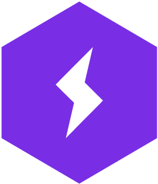

## Hi there, <a href="#"></a> I'm [Mir Sazzat Hossain!](https://mirsazzathossain.me/) <a href="https://wakatime.com/@fe38a003-9d88-400e-b624-e41ac19ee0d4"></a> 

I am working as an **AI Engineer** 🧑‍💻 at [**Penta Global Limited**](https://www.pentabd.com/), and was previously a **Research Assistant** 🧑‍🔬 at the [**Center for Computational & Data Sciences (CCDS)**](http://ccds.ai/) at **Independent University, Bangladesh** 🏛️. My research is in **natural language processing**, with a focus on **LLM agents**, **LLM post-training**, and the **evaluation of language and vision-language models** 💻. Currently, I am working on **reinforcement learning**, **adversarial policy optimization**, and **on-policy self-distillation** for LLMs, especially in settings without **labeled data** 🔥. My work has been published at **ACL**, **WACV** and **AACL** 🔬.

I am looking for **Ph.D. positions** in Computer Science starting Fall 2027 🤓. Feel free to reach out to discuss **ideas** or ask research-related questions 💬!

<p><a href="mailto:mirsazzathossain@gmail.com"></a> <a href="https://www.linkedin.com/in/mirsazzathossain/"></a> <a href="https://discord.com/users/543109302848585740"></a></p>
<br>

## ⚡ A Few Quick Facts:


- 📖 Currently working on **test-time RL** for search agents and **on-policy self-distillation**.
- 🛠️ Primary stack: **PyTorch** · **Hugging Face** · **vLLM** · **TRL** · **verl**.
- 🤝 Open to research collaborations on **LLM agents**, **RL for LLMs**, or **Bangla NLP**.
- 🎓 Actively applying to **Ph.D. programs** in CS for Fall 2027, focusing on **NLP** and **LLM post-training**.
- 🗂️ Check out my [research projects](https://mirsazzathossain.me/projects).
- 💬 Ask me about research, paper writing, or grad school.
- 📫 Reach me at: [Gmail](mailto:mirsazzathossain@gmail.com)
- 😄 Pronouns: He/Him
- 🧾 Check out my [resume](https://mirsazzathossain.me/files/mirsazzathossain-cv.pdf).
- 📝 I write on [my blog](https://mirsazzathossain.me/articles).
- ⚡ Fun fact: Reviewer #2 lives rent-free in my head 🤣
<br>

## 🛠️ Languages and Tools I use:

<p align="center"> 
    <!-- Languages -->
    <a href="https://www.python.org" target="_blank"> 
        <code></code> 
    </a> 
    <!-- ML Frameworks -->
    <a href="https://pytorch.org/" target="_blank"> 
        <code></code> 
    </a> 
    <a href="https://lightning.ai/" target="_blank"> 
        <code></code> 
    </a> 
    <a href="https://huggingface.co" target="_blank"> 
        <code></code> 
    </a> 
    <a href="https://langchain-ai.github.io/langgraph/" target="_blank"> 
        <code></code> 
    </a> 
    <!-- Tools -->
    <a href="https://jupyter.org/" target="_blank"> 
        <code></code> 
    </a> 
    <a href="https://git-scm.com/" target="_blank"> 
        <code></code> 
    </a> 
    <a href="https://cursor.com" target="_blank"> 
        <code></code> 
    </a> 
    <a href="https://www.anthropic.com" target="_blank"> 
        <code></code> 
    </a> 
    <a href="https://openai.com/codex" target="_blank"> 
        <code></code> 
    </a> 
    <a href="https://www.linux.org/" target="_blank"> 
        <code></code> 
    </a> 
    <!-- Cloud -->
    <a href="https://aws.amazon.com" target="_blank"> 
        <code></code> 
    </a>
</p>
<br>

## 🏆 GitHub Trophies:

<p align="center">
    
</p>
<br>

## 📈 GitHub Contribution Graph:

<div align="center">
    
</div>
<br>

## 📊 GitHub Stats:

 
<br>

## 🕑 Wakatime Stats:

<!--START_SECTION:waka-->


**🐱 My GitHub Data** 

> 📦 1.9 MB Used in GitHub's Storage 
 > 
> 🏆 526 Contributions in the Year 2026
 > 
> 💼 Opted to Hire
 > 
> 📜 44 Public Repositories 
 > 
> 🔑 34 Private Repositories 
 > 
**I'm a Night 🦉** 

```text
🌞 Morning                388 commits         ██░░░░░░░░░░░░░░░░░░░░░░░   09.05 % 
🌆 Daytime                1265 commits        ███████░░░░░░░░░░░░░░░░░░   29.51 % 
🌃 Evening                1085 commits        ██████░░░░░░░░░░░░░░░░░░░   25.31 % 
🌙 Night                  1548 commits        █████████░░░░░░░░░░░░░░░░   36.12 % 
```
📅 **I'm Most Productive on Monday** 

```text
Monday                   779 commits         █████░░░░░░░░░░░░░░░░░░░░   18.18 % 
Tuesday                  729 commits         ████░░░░░░░░░░░░░░░░░░░░░   17.01 % 
Wednesday                686 commits         ████░░░░░░░░░░░░░░░░░░░░░   16.01 % 
Thursday                 443 commits         ███░░░░░░░░░░░░░░░░░░░░░░   10.34 % 
Friday                   731 commits         ████░░░░░░░░░░░░░░░░░░░░░   17.06 % 
Saturday                 467 commits         ███░░░░░░░░░░░░░░░░░░░░░░   10.90 % 
Sunday                   451 commits         ███░░░░░░░░░░░░░░░░░░░░░░   10.52 % 
```


📊 **This Week I Spent My Time On** 

```text
🕑︎ Time Zone: Asia/Dhaka

💬 Programming Languages: 
JSON                     1 hr 8 mins         █████░░░░░░░░░░░░░░░░░░░░   20.36 % 
MDX                      1 hr                █████░░░░░░░░░░░░░░░░░░░░   18.02 % 
Astro                    54 mins             ████░░░░░░░░░░░░░░░░░░░░░   16.15 % 
Image (svg)              49 mins             ████░░░░░░░░░░░░░░░░░░░░░   14.65 % 
TypeScript               44 mins             ███░░░░░░░░░░░░░░░░░░░░░░   13.30 % 

🔥 Editors: 
Claude Code              5 hrs 35 mins       █████████████████████████   99.56 % 
VS Code                  1 min               ░░░░░░░░░░░░░░░░░░░░░░░░░   00.44 % 

🐱‍💻 Projects: 
mirsazzathossain.me      5 hrs 36 mins       █████████████████████████   100.00 % 

💻 Operating System: 
Linux                    5 hrs 36 mins       █████████████████████████   100.00 % 
```

**I Mostly Code in Python** 

```text
Python                   34 repos            ███████████░░░░░░░░░░░░░░   44.16 % 
Jupyter Notebook         14 repos            █████░░░░░░░░░░░░░░░░░░░░   18.18 % 
PLpgSQL                  1 repo              ░░░░░░░░░░░░░░░░░░░░░░░░░   01.30 % 
TypeScript               1 repo              ░░░░░░░░░░░░░░░░░░░░░░░░░   01.30 % 
C#                       1 repo              ░░░░░░░░░░░░░░░░░░░░░░░░░   01.30 % 
```


<!--END_SECTION:waka-->

<p align="center">
  
</p>
